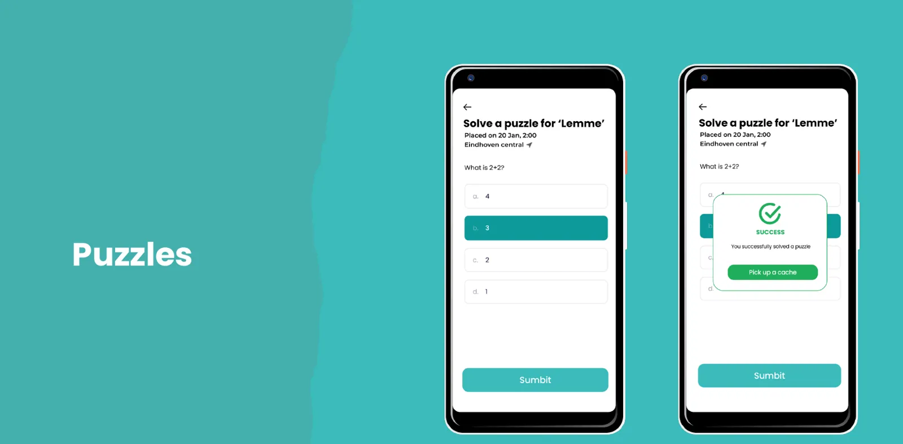
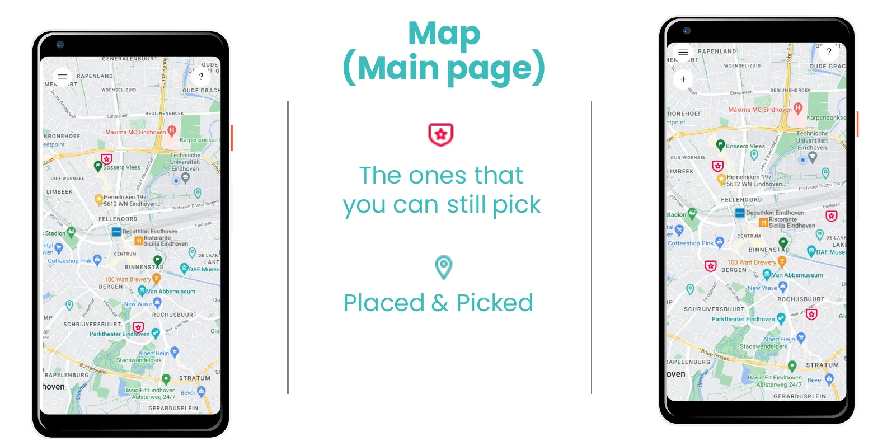
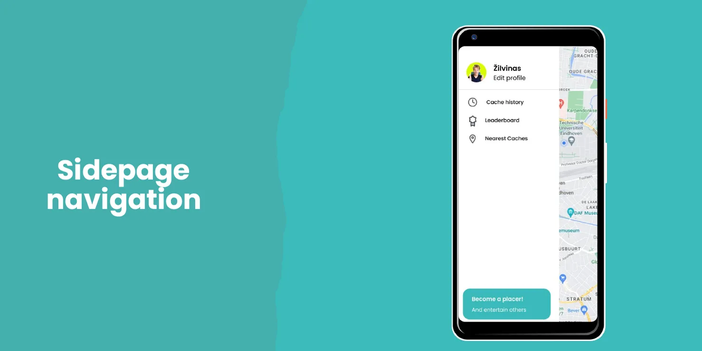

# GeoTreasure, a geocaching app for Android

GeoTreasure turns a walk into a treasure hunt. Players see caches on a map, walk to them and solve a small puzzle to collect them, while placers hide new caches for others to find. We built it with a team of four in the course **DBL App Development** at Eindhoven University of Technology (2023), with the goal of promoting physical activity in a fun way.

> This repository contains only the screens and code I worked on, not the whole app, so it will not build on its own. The full app used Firebase for accounts and data and Google Maps for the map.

## What I did

- **UI design:** I designed the user interface in Figma and then built the screens in Android Studio together with a teammate.
- **Screens:** the placer home screen, the form to register a new cache, the profile, the side menu and the map markers.
- **Puzzles:** the three puzzle pages (maths, trivia and sudoku), together with another teammate.
- **Documents and testing:** I did most of the work on the project documents, including the requirements, the user interface document and the acceptance test plan, and I tested the app.

## What is in this repository

| Path | What it is |
|---|---|
| `res/layout/` | The XML layouts of my screens (puzzles, placer home, cache configuration, profile, side page) |
| `res/values/` | Colours, strings and themes |
| `java/Player/` | The three puzzle pages and their question banks |
| `java/Placer/` | The placer home screen and the form to register a new cache |
| `java/SidePage/` | The side menu and the profile |
| `java/User/Map.java` | Placing the cache markers on the map |

## What I learned

I was hoping for more programming and less paperwork in this course, and a lot of our time went into documents. On the bright side, it was the project where I really got into user interface design and its implementation in Android Studio, and I am glad I had the chance to explore it in detail. If I did it again, I would split the documents into smaller tasks with deadlines early on, so there is more time left for the app itself.

---

Made by **Mariana Angelova** as part of a team of four · [Portfolio](https://AngelovaM2.github.io)
